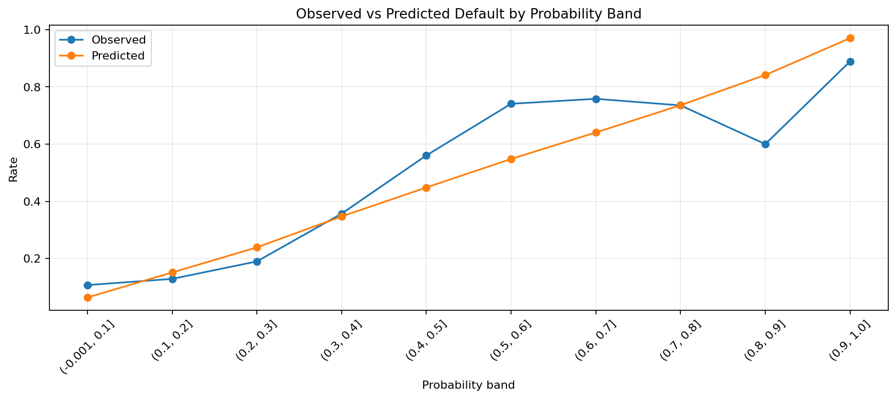
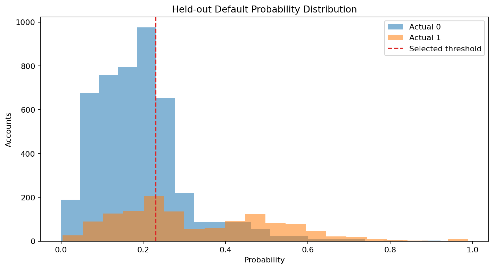
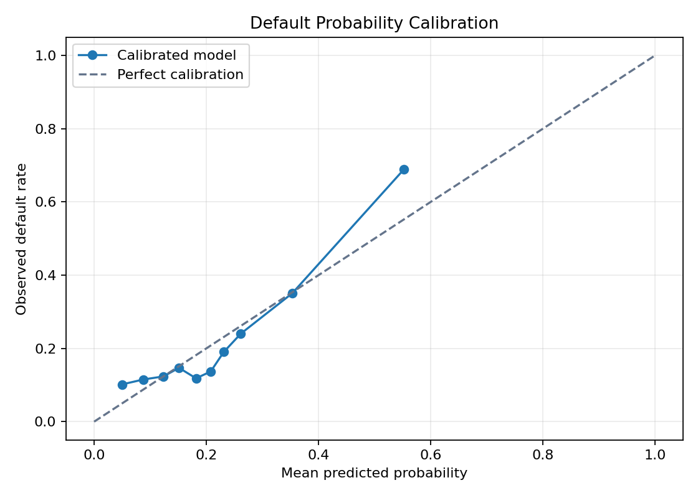
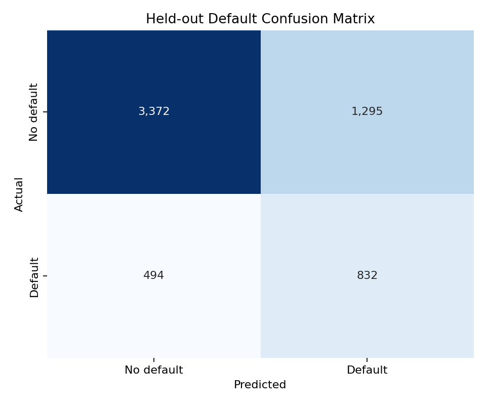

# Calibrated Credit Default Risk

**Author:** Mohammed Adeen Shaik  
**Review date:** 11 October 2026

## Research question

How does a calibrated baseline trade off missed defaults against false alerts under an explicit cost assumption?

## Data and provenance

UCI Default of Credit Card Clients dataset.

Source materials are linked from the repository README. Input fingerprints are recorded in [the evidence manifest](evidence.json) so a reader can identify the exact committed artifacts used in this review.

## Method and analytical rationale

Training-only imputation and scaling precede class-weighted logistic regression. Five-fold sigmoid calibration estimates probability corrections. Validation data selects a threshold under an assumed 5:1 error-cost ratio; test data measures the locked decision.

## Findings and interpretation

Fresh execution on 11 October 2026 using the committed pipeline and seed 42. Five-fold sigmoid calibration was fitted only on training partitions. On **5,993** held-out records, precision was **39.1%**, recall **62.7%** and average precision **0.5092**. The test set contained **494** missed positives and **1295** false alerts. These are retrospective sample results.

| Measure | Value |
|---|---:|
| average precision | 0.5092 |
| roc auc | 0.7263 |
| brier score | 0.1452 |
| precision | 0.3912 |
| recall | 0.6275 |
| f1 | 0.4819 |
| expected classification cost | 3765.0000 |
| true negatives | 3372 |
| false positives | 1295 |
| false negatives | 494 |
| true positives | 832 |
| decision threshold | 0.2300 |
| validation cost at threshold | 3685.0000 |
| false negative cost | 5.0000 |
| false positive cost | 1.0000 |
| default prevalence | 0.2213 |
| train rows | 17979 |
| validation rows | 5993 |
| test rows | 5993 |
| random seed | 42 |

## Limitations

Assumed error costs are not observed financial losses. Historical Taiwan records do not establish suitability for current Canadian lending. Demographic variables need fairness review before any operational use.

## Reproduction

Use the setup commands and input contract in the [repository README](https://github.com/Adeen1607/credit-default-risk#readme). Open the [notebook catalogue](notebooks.html) for annotated code and saved outputs. Keep raw records and model binaries local; public reports contain aggregate results or source-embedded figures.

## Final visual results

*Figure from key_visuals.ipynb, original code cell 3.*

*Figure from key_visuals.ipynb, original code cell 4.*

*Held-out evaluation figure: calibration_curve.png.*

*Held-out evaluation figure: confusion_matrix.png.*

